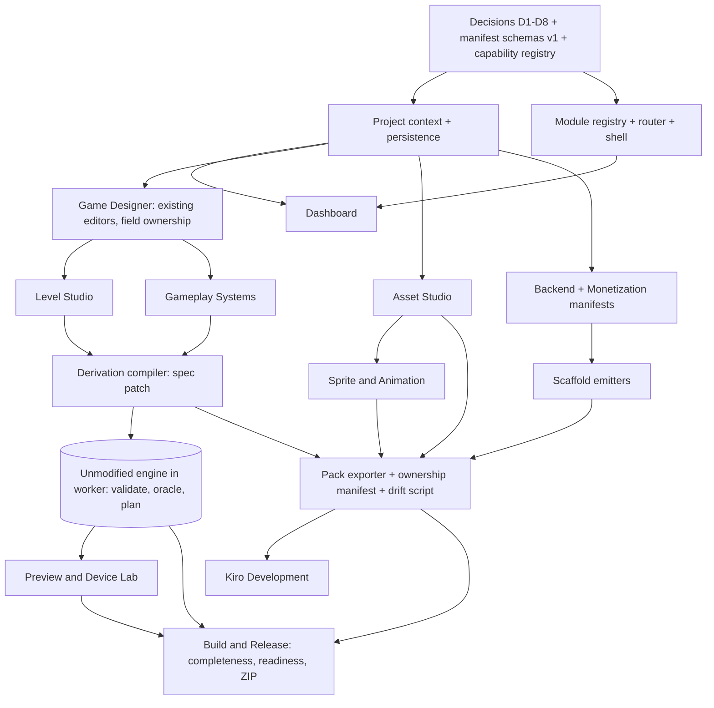

# Studio Foundry: design
Status: **DRAFT for owner approval (2026-11-16).** Requirements: `requirements.md`. Tasks: `tasks.md`.
Everything marked "verified" was read from the repository at `71c77e4`. Everything else is a proposal.

## 0. The central constraint and the decision it forces
The canonical spec (v4) cannot express assets, animations, multiple levels, ads or backend, and it is frozen for G6. Studio may not hold configuration the schema cannot express (steering 07) and may not touch `spec/schema/` or `tools/monstera/` in this milestone.

The design therefore has **two layers and one compile step**:

```
 Studio pack (Studio-owned, versioned manifests + asset bytes)      Canonical spec v4 (engine-owned semantics)
   assets, animations, levels, gameplay, integrations   --compile-->  monstera.spec.json  --engine-->  android/ ios/
        (never read by the engine in this milestone)       only the fields v4 can express        unchanged generator
```
- What v4 can express (lives, win score, collisions, kinds, initial entities, spawners) is **compiled** from Level Studio and Gameplay Systems into the spec. The engine validates it, the oracle runs it, the native apps play it. These capabilities reach native code for real.
- What v4 cannot express (sprites, audio, animation, ads, backend, multi-level selection, power-ups) is **stored, validated, previewed in Studio and exported** in the Studio pack with its status shown as `prototype`, `mock` or `planned`. It does not reach the native render path unless the engine track (section 6) is approved and built.

This is an honest limit of the milestone, and the UI, the export README and the demo script state it. The alternative (changing the frozen generator now) is the engine track, with its cost in section 6.

### Decisions needing the owner
| ID | Decision | Recommendation | If rejected |
|---|---|---|---|
| D1 | Two-layer model: Studio pack beside an unchanged v4 spec | Accept | No alternative without changing the schema |
| D2 | Studio validates its own manifests in TypeScript against Studio-owned JSON Schemas in `studio/schemas/`, with the engine's discipline. Amend steering 07 ("Studio holds no validation logic") to say: engine is authority for the spec; Studio is authority for Studio-owned manifests | Accept | Move manifest validation into the engine: touches `tools/monstera/`, unacceptable now |
| D3 | Derivation is opt-in per project and per module, default off. Off equals today's behaviour exactly | Accept | n/a |
| D4 | Multi-level in the shipped app is **not** in this milestone; levels export as one spec variant each | Accept | Needs engine track E1 |
| D5 | Engine track E1 (sprite reference plus extension source roots) is decided at a gate on 2026-11-19 | Decide at the gate; default **no** | See section 6 |
| D6 | No in-browser AI. Proposal inbox plus manual handoff is the only AI path | Accept | A hosted provider needs a backend: out of scope |
| D7 | Production ad unit ids are never entered in Studio | Accept | Weaker secret hygiene, no benefit for the demo |
| D8 | Add steering `11-studio-foundry.md` (ownership classes, status vocabulary, derivation rule) | Accept | Rules live only in this spec |

## 1. Current versus proposed capability matrix
`Today` is verified. `Target` is the status when the milestone is accepted. `Native` says whether the capability reaches the generated Kotlin/Swift app in the committed plan (Tier A).
| Module | Today | Target | Native (Tier A) | Needs engine change |
|---|---|---|---|---|
| 1 Dashboard | Absent. Overview section, three templates, one `localStorage` draft | implemented: multi-project, status cards, bundle in/out | n/a | no |
| 2 Game Designer | **Implemented**: Overview, Platforms, Gameplay, Entities, Rules, Spawns, Presentation, Spec, validation, rename cascade | implemented (moved, plus field ownership) | yes (it is the spec) | no |
| 3 Asset Studio | Absent. Spec has `glyph` only | prototype: import, provenance, assign by id, export | no | yes (render/play) = E1/E2 |
| 4 Sprite and Animation | Absent | prototype: slice, frames, animations, tick-based preview, manifest | no | yes = E1 |
| 5 Level Studio | Absent. One runtime per spec | prototype: N levels, active level compiles to spawners and placements, variants export | active level only | yes for in-app selection, wave end, per-level win = E3 |
| 6 Gameplay Systems | Partly: lives, winScore, collisions editable under Rules | implemented for lives, score, collectibles, enemies; prototype for difficulty ramp; planned for health, power-ups, progression | yes (compiles to v4 fields) | yes for the planned ones |
| 7 Backend and Services | Absent | mock stubs plus scaffold and `SETUP.md`; live connection planned | no (extension root) | yes to compile = E2 |
| 8 Monetization | Absent | mock rewarded ad plus placement config and interfaces; real SDK planned | no (extension root) | yes to compile = E2 |
| 9 Kiro Development | Developer Integration static inventory; MCP, hooks, agents exist; ownership manifest exists for generator files | implemented: pack export, ownership manifest, drift check, `.kiro` templates, write-once extension roots | yes for files; extension code not compiled without E2 | no |
| 10 Preview and Device Lab | **Implemented**: preview, determinism badge, native evidence panel. Device Lab (G5) adapters are scripts, not in Studio | implemented: adds environment table. Device testing stays `no evidence` unless committed | yes | no |
| 11 Build and Release | Source ZIP export only | implemented: completeness check, readiness checklist, pack export. No store-ready claim | yes | no |
| AI authoring | Prompts in Developer Integration; MCP in Kiro | prototype: proposal inbox, manual provider | n/a | no |

Explicitly **unsupported** (listed in the capability list, no controls): hosted AI provider, live Firebase/AdMob connection from Studio, signing, store upload, remote build, native-code reverse engineering, three-way merge, wave end/count, per-level win rule, in-app level select (until E3).

## 2. Information architecture and navigation
Route: `#/<module>[/<section>]`. The existing `sectionFromHash` is replaced by a module registry; legacy single-segment hashes redirect so bookmarks, the smoke test and acceptance scripts keep working during migration.
| Module (route) | Sections (home of existing section in brackets) |
|---|---|
| Dashboard (`dashboard`) | Projects, Status |
| Game Designer (`designer`) | Overview, Platforms, World and input (Gameplay), Entities, Rules, Spawns, Presentation, Spec |
| Asset Studio (`assets`) | Library, Provenance |
| Sprite and Animation (`sprites`) | Sheets, Frames, Animations |
| Level Studio (`levels`) | Levels, Timeline |
| Gameplay Systems (`gameplay`) | Modules, Planned |
| Backend and Services (`backend`) | Firebase |
| Monetization (`monetization`) | Placements, Mock behaviour |
| Kiro Development (`kiro`) | Handoff and proposals, Developer Integration, Drift |
| Preview and Device Lab (`preview`) | Play, Determinism, Environments, Native evidence |
| Build and Release (`release`) | Completeness, Export, Readiness |
Legacy redirects: `overview platforms entities rules spawns presentation spec` to `designer/*`; `gameplay` to `designer/world`; `determinism` to `preview/determinism`; `export` to `release/export`; `integration` to `kiro/integration`.
Shell: left rail (modules, each with a status dot from the registry), top bar (project name, validation state, spec hash), right panel (validation issues, shared). Mobile: rail collapses to a menu.
The `planned`/`unsupported` modules or sections render a single explanatory card (what is missing, which contract piece it needs) and no form.

## 3. Shared project data model and manifests
### 3.1 Pack layout (exported and imported; stored in IndexedDB as the same tree)
```
<project-root>/
  monstera.spec.json                  canonical v4, written with the engine's own serializer
  studio-pack/
    project.json                      monstera.studio.project v1   identity, bindings, derivation switches
    assets.json                       monstera.studio.assets v1
    animations.json                   monstera.studio.animations v1
    levels.json                       monstera.studio.levels v1
    gameplay.json                     monstera.studio.gameplay v1
    integrations.json                 monstera.studio.integrations v1  (backend + monetization, no secrets)
    assets/<asset-id>/<file>          bytes, content-addressed by assets.json
    derived/levels/<level-id>/monstera.spec.json     compiled variants (studio-scaffold class)
    scaffold/{android,ios}/...        Kotlin/Swift interfaces, mock providers, SETUP.md (studio-scaffold)
    PROJECT-NOTES.md                  write-once
  extensions/{android,ios}/README.md  write-once, developer-owned
  MONSTERA-STUDIO-MANIFEST.json       sha256 + class for every Studio-written file
  tools/check-drift.sh                POSIX drift check
  android/ ios/ MONSTERA-MANIFEST.json .kiro/steering/monstera-generated.md   engine-owned, unchanged
  .kiro/steering/*.md .kiro/specs/<project>/*.md .kiro/hooks/*.json            write-once templates
```
The folder is named `studio-pack`, not `studio`, so it cannot be confused with the repository's `studio/` directory.

### 3.2 Common rules for every manifest (same discipline as the spec schemas)
- Envelope: `{ "schema": "monstera.studio.<name>", "version": 1, ... }`. A reader refuses an unknown `schema` or a higher `version`; migration functions are pure and tested.
- Every property required, `additionalProperties: false`, unsupported schema keywords fail at load. Game quantities are integers (Q16.16 raw where they are spec quantities, plain integers for pixels, ticks and fps). No floats anywhere.
- Ids: `^[a-z][a-z0-9-]{1,31}$`, unique per manifest, immutable once created, never reused. Arrays are sorted by id except where order is meaning (`frames` in an animation, `levels` by `order`).
- No timestamps written by Studio. Dates, if any, are user-entered strings inside provenance.
- Serialization: key order as in the schema, 2-space indent, LF, trailing newline. A TS canonicalizer produces it; a golden-file test pins it. The spec itself is always written by the engine's serializer, never by TS.
- Duplicate keys, BOM, invalid UTF-8, `__proto__`/`constructor` keys: refused (mirrors the engine's strict JSON reader).

### 3.3 `project.json`
```json
{ "schema": "monstera.studio.project", "version": 1,
  "projectId": "lantern-run",
  "spec": { "path": "monstera.spec.json", "baseSha256": "<64 hex: spec before any derivation>", "currentSha256": "<64 hex>" },
  "engine": { "gitCommit": "<40 hex, from the Studio build stamp>" },
  "derivation": { "levels": false, "gameplay": false, "activeLevel": "" },
  "derived": { "inputsSha256": "<64 hex over canonical levels+gameplay+base spec, or empty>" },
  "modules": ["assets","animations","levels","gameplay","integrations"] }
```
`projectId` equals `spec.project.id` (checked). `inputsSha256` lets Studio say "derived spec out of date" without recompiling.

### 3.4 `assets.json`
```json
{ "schema": "monstera.studio.assets", "version": 1, "nextSeq": 3,
  "assets": [ { "id": "asset-lantern-sheet", "kind": "image", "category": "sprite",
      "file": "lantern-sheet.png", "mime": "image/png", "bytes": 18234, "sha256": "<64 hex>",
      "width": 256, "height": 64, "durationMs": 0, "kindRefs": ["lantern"],
      "provenance": { "origin": "user-owned", "author": "A. Author", "license": "proprietary-owned",
                      "source": "drawn by author", "tool": "", "model": "", "promptSha256": "", "acquiredOn": "", "notes": "" } } ] }
```
`kind` is `image` or `audio`. `category`: `sprite`, `background`, `ui`, `sfx`, `music`. `durationMs` is 0 for images. `nextSeq` guarantees ids are not reused after deletion. Files live at `assets/<id>/<file>`; `file` is a basename (`^[A-Za-z0-9._-]{1,64}$`, no path separators, no leading dot).

### 3.5 `animations.json`
```json
{ "schema": "monstera.studio.animations", "version": 1,
  "sheets": [ { "id": "sheet-lantern", "assetId": "asset-lantern-sheet",
      "grid": { "frameWidth": 32, "frameHeight": 32, "columns": 8, "rows": 2, "margin": 0, "spacing": 0 },
      "frames": [ { "id": "f0", "x": 0, "y": 0, "w": 32, "h": 32 } ] } ],
  "animations": [ { "id": "lantern-idle", "sheetId": "sheet-lantern", "kindRef": "lantern",
      "fps": 8, "loop": "loop", "sequence": [ { "frameId": "f0", "holdFrames": 1 } ] } ] }
```
Frame rectangles are pixel integers inside the image bounds (checked against `assets.json` width and height). `loop` is `once|loop|pingpong`. Frame index function (pure, integer):
`step = floor(tick * fps / tickRate)`; `slot = step mod totalHold` for `loop`, `min(step, totalHold-1)` for `once`, and a triangle wave over `2*totalHold-2` for `pingpong`; the slot maps through cumulative `holdFrames` to a sequence entry. Hand-computed cases are the test oracle (task 3.1).

### 3.6 `levels.json`
```json
{ "schema": "monstera.studio.levels", "version": 1,
  "levels": [ { "id": "level-1", "name": "Dusk", "order": 1,
      "placements": [ { "id": "p1", "kind": "player", "x": 983040, "y": 1900544 } ],
      "waves": [ { "id": "w1", "kind": "ghost", "startTick": 60, "intervalTicks": 90,
                   "xMin": 0, "xMax": 1900544, "yMin": 0, "yMax": 0, "vx": 0, "vy": 65536 } ],
      "difficulty": [ { "id": "d1", "waveId": "w1", "atTick": 1800, "intervalTicks": 60 } ] } ] }
```
Units are the spec's (raw Q16.16), shown to the user in game units like today. `kind` must exist in the base spec. `difficulty` steps compile to an extra spawner (same kind and ranges as the wave, `startTick = atTick`, new interval) because v4 spawners cannot be changed or stopped. Compile limits: total spawners and initial entities respect the schema maxima; a violation is reported against the level, not the spec.

### 3.7 `gameplay.json`
```json
{ "schema": "monstera.studio.gameplay", "version": 1,
  "lives": { "start": 3 },
  "score": { "winScore": 0 },
  "collectibles": [ { "id": "c1", "kind": "candy", "collectorKind": "player", "points": 10, "despawn": true } ],
  "enemies": [ { "id": "e1", "kind": "ghost", "targetKind": "player", "livesLost": 1, "despawnEnemy": true } ],
  "planned": [] }
```
`planned` is always the empty array in v1 (reserved so a later version can add `health`, `powerUps`, `progression` without a breaking change). Compile: `collectibles` and `enemies` produce `runtime.collisions` rows (`a`, `b`, `despawnA`, `despawnB`, `score`, `lives`), `lives.start` and `score.winScore` produce `runtime.lives` and `runtime.winScore`. Collision rows not produced by a module are Designer-owned and must not collide with a module row (same kind pair): reported as an error.

### 3.8 `integrations.json`
```json
{ "schema": "monstera.studio.integrations", "version": 1,
  "backend": { "provider": "firebase", "services": { "auth": false, "firestore": false, "analytics": false, "crashlytics": false, "remoteConfig": false },
               "status": "scaffold", "configFiles": ["google-services.json", "GoogleService-Info.plist"] },
  "monetization": { "provider": "admob", "mode": "mock",
      "placements": [ { "id": "interstitial-gameover", "type": "interstitial", "trigger": "game-lost",
                        "minSecondsBetween": 120, "maxPerSession": 3, "rewardKind": "", "rewardAmount": 0 } ] } }
```
No ids, no keys, no URLs. `configFiles` is a fixed list of file names the developer adds to the native projects, git-ignored by the exported `.gitignore`. `mode` is `mock` or `test`. Enum values for `mode`/`status` never include `production` or `live`.

### 3.9 Binding to evidence
Native evidence, determinism and conformance remain bound to the **exact spec SHA-256** as today. Derived compilation changes the spec hash on purpose; the badge and evidence panel then say `no evidence for this hash` until a fresh run exists. That is correct and must not be softened.

## 4. Module dependency diagram

Hard serial dependencies: manifest schemas (0.3) before any module that stores data; the derivation compiler contract before Level and Gameplay UIs; the pack layout before the exporter. Everything else is independent (task graph in `tasks.md`).

## 5. Frontend component architecture
Existing (verified): `app/` (hooks, navigate, prefs, sections, session), `engine/` (worker client, protocol, glue.py), `draft/` (store, ops, path, summary), `ui/` (TopBar, ValidationPanel, SpecView, fields, sections/*), `preview/`, `badge/`, `export/zip.ts`, `integration/`.
New, all under `studio/src/`, no new runtime dependency planned (React 19 and the platform's `IndexedDB`, `createImageBitmap`, `crypto.subtle`, `CompressionStream` suffice; a new dependency needs a written reason per steering 01):
```
app/registry.ts            ModuleInfo { id, title, status, sections[], requires[] } ; capabilities from studio/capabilities.json
app/router.ts              hash <-> (module, section); legacy redirects
project/context.tsx        ProjectProvider: current project, manifests slices, dirty state, undo stack
project/store.ts           IndexedDB persistence (projects, blobs), draft.v1 migration, quota handling
project/manifests/*.ts     one file per manifest: types, canonicalize, migrate, validate (schemas in studio/schemas/)
project/refs.ts            cross-reference index: kind -> {assets, animations, levels, gameplay}; blocks deletes
project/derive/            levels.ts, gameplay.ts (pure compilers), apply.ts (compile -> engine validate -> oracle -> commit or reject)
project/validate.ts        aggregator: engine issues + manifest issues + cross-ref issues -> one list with module/field targets
assets/                    sniff.ts (magic bytes), limits.ts, import.ts, provenance.ts, AssetLibrary.tsx
sprites/                   slice.ts, frames.ts (ops), timeline.ts (tick->frame), SheetEditor.tsx, AnimationEditor.tsx, Player.tsx
levels/                    LevelList.tsx, LevelCanvas.tsx (reuses preview drawing), Timeline.tsx
gameplay/                  Modules.tsx, Planned.tsx
integrations/              Backend.tsx, Monetization.tsx, scaffold/*.ts (Kotlin and Swift text emitters), secrets.ts (field guard)
pack/                      layout.ts, export.ts, import.ts, manifest.ts (MONSTERA-STUDIO-MANIFEST), drift.ts, templates/ (kiro steering/spec/hook text, check-drift.sh)
release/                   completeness.ts, readiness.ts, Release.tsx
ui/                        Shell.tsx (rail, top bar, status dots), CapabilityBanner.tsx, ModuleCard (planned/unsupported)
proposals/                 schema, apply, diff view (the AI inbox)
```
State rules: one source of truth per datum. Spec text lives in the existing draft store; manifests live in the project context; the aggregator derives everything else. Components never call the engine directly; they use the existing client (a worker request queue). Heavy work (hashing assets, oracle runs, compiling N level variants) runs in the worker or via `crypto.subtle`, so the UI stays responsive (the M0 spike measured responsiveness; the same budget applies).
The scaffold emitters are text generators whose **pure logic functions** (frequency limiter, mock reward) are specified once in TypeScript (tested) and rendered into Kotlin and Swift text; a test compiles nothing, so the generated Kotlin/Swift stays `GENERATED`, not `COMPILED`. If E2 is not built, no native compile evidence exists for scaffolds, and the UI says so.

## 6. Engine and generator extension points
Verified fact: the generator owns `android/` and `ios/` completely, and the templates have no hook for extra source sets, resources or per-kind sprites. So every item below changes the frozen generator and is **outside the committed plan**.
| ID | Extension | Minimal shape | Why it matters | Cost, honest estimate | Gate |
|---|---|---|---|---|---|
| E1 | `kinds[].sprite` (asset id plus animation id) as presentation data, plus bundling asset files into both apps | Schema v5 additive field (like `glyph`/`effect` in the v4 visual batch), contract section, oracle ignores it, both presentation modules draw it, resources copied by the template | Makes Asset and Sprite modules real in native apps | The v4 visual batch is the precedent: schema, emitters, two presentation modules, goldens re-recorded (checkpoints unchanged), conformance, CI. Estimate 5 to 7 working days for one person | Owner decision on 2026-11-19, a separate branch, a new freeze, and a statement that G6 evidence stays relative to `71c77e4` |
| E2 | Developer-owned source roots compiled into the app (`extensions/android` as a Gradle source set, `extensions/ios` as a SwiftPM target) | Template change only, no schema change | Makes ad and Firebase scaffolds compile and the mock rewarded ad visible in the app | 3 to 4 days including CI builds on both platforms | Same gate |
| E3 | Level table in the spec (`levels[]`, active selection, wave end tick, per-level win) | Schema v5, contract, oracle, both runtimes, scenarios, mutants | Multi-level in the shipped app | Not feasible before the deadline | Post-deadline |
Rules if any E item is approved: follow the steering 08 order (contract, oracle with hand-computed tests, scenario, mutant, Kotlin, Swift); no `if (game)` branches; Studio changes are separate tasks that wait for the merged contract (steering 06). The Studio plan in `tasks.md` is written so that E1 or E2 later **adds** native wiring and does not require rework of manifests (the manifests already carry `kindRefs`, `animations.kindRef` and the extension roots).
Recommendation: do not start E1 or E2 before the P0 Studio criteria (A1 to A7) are green on the feature freeze date; if they are, E2 is the cheaper and more demonstrable choice because it turns the scaffold and the MOCK label into something visible on a simulator.

## 7. Data ownership and generated/native boundaries
| Class | Examples | Who writes | On re-export | Drift reported |
|---|---|---|---|---|
| engine-owned | `android/`, `ios/`, `MONSTERA-MANIFEST.json`, `.kiro/steering/monstera-generated.md` | `monstera generate` (inside Studio: the engine in the worker) | Regenerated, hash-verified by `monstera verify` | by the engine, unchanged |
| spec | `monstera.spec.json` | Studio (engine serializer) or the developer/Kiro | Replaced only from the Studio project; an import shows a diff first | n/a |
| studio-data | `studio-pack/*.json`, `studio-pack/assets/**` | Studio or the developer (hand edits allowed, validated on import) | Studio's copy wins unless the import is newer and accepted by the user | hash differs from manifest: "edited" (informational) |
| studio-scaffold | `studio-pack/scaffold/**`, `studio-pack/derived/**` | Studio only | Rewritten; if edited, the user chooses keep or overwrite | edited or missing: **drift**, exit non-zero |
| write-once | `extensions/**`, `.kiro/steering/*` (other than the engine file), `.kiro/specs/<project>/`, `.kiro/hooks/`, `PROJECT-NOTES.md`, `.gitignore` | Studio once, then the developer | Never overwritten | never |
Native developer code goes in `extensions/` (write-once). Until E2, nothing compiles it; the README in each extension root says so in its first line.
Generated vs hand-written is visible by path and by manifest. Studio-scaffold files carry the header `GENERATED by MONSTERA Studio <build> - do not edit` where the format allows (Kotlin, Swift, shell, Markdown comment).
`tools/check-drift.sh` in the export is the Kiro-side command. It checks `MONSTERA-STUDIO-MANIFEST.json` only. For engine files the existing `monstera verify` and `generate --check` remain the commands. The exported steering says which to run.
The existing hook `guard-generated-output` protects `generated/`. The export ships a variant that also warns on edits to `studio-pack/scaffold/**` and `android/`/`ios/` in the exported project (hook text only; hooks are the developer's).

## 8. Security and integration architecture
### 8.1 Trust boundaries and controls
| Boundary | Threat | Control |
|---|---|---|
| User file to Studio (image, audio) | Malicious or oversized file, SVG script, polyglot, decompression bomb | Content sniffing by magic bytes; allowlist PNG, JPEG, WebP, GIF, WAV, OGG, MP3; SVG refused; limits 5 MiB per file, 64 MiB per project, 4096 px per side, 256 assets; decode in `createImageBitmap` with try/catch; image dimension read from the header **before** decode; assets never inserted as HTML, only as `blob:` URLs to ``/`<audio>`; audio never autoplays |
| Project bundle or pack import | Zip-slip, absolute paths, symlinks, duplicate entries, zip bombs, `__proto__` keys | Existing `zip.ts` adversarial tests extended: normalize and reject any entry outside the pack layout; reject duplicates; cap entry count (2,000), per-entry and total uncompressed size (64 MiB), compression ratio (100:1); parse JSON with the strict reader; validate before touching the project; an import is atomic |
| Manifest text fields to export | Injection into generated Kotlin/Swift/Markdown/shell | Identifiers restricted by regex; free text (names, notes) is never interpolated into code, only into Markdown after escaping; code emitters take only ids, enums and integers |
| Studio bundle | Secret or key in `dist/` | Extended `scan-secrets` patterns: `AIza[0-9A-Za-z_-]{35}`, `-----BEGIN (RSA |EC )?PRIVATE KEY-----`, `"type": "service_account"`, `ca-app-pub-` with a non-test publisher, `AKIA[0-9A-Z]{16}`, `firebase` API-key assignments, provider hostnames of AI APIs; findings never print values; runs on `dist/`, source maps, sample packs and generated exports |
| User pastes a secret into a field | Secret persisted in IndexedDB or ZIP | `secrets.ts` field guard rejects values matching the same patterns before they enter state; test with each pattern |
| Browser origin | XSS, third-party script, exfiltration | No third-party script; no outbound request (existing M2 assertion kept); a CSP via `studio/vercel.json` headers: `default-src 'self'; script-src 'self' 'wasm-unsafe-eval'; img-src 'self' blob: data:; media-src 'self' blob:; worker-src 'self' blob:; connect-src 'self'; object-src 'none'; frame-ancestors 'none'`, plus `X-Content-Type-Options: nosniff`. Needs verification that Pyodide loads under it (task 1.6). The deployment itself is the owner's |
| Exported native apps | Ad ids, Firebase config in Git or binaries | Studio never writes real ids; export `.gitignore` lists `google-services.json`, `GoogleService-Info.plist`, `*.keystore`, `local.properties`; `SETUP.md` tells the developer to supply files and uses Google's published test ids only after verifying them against Google's current documentation at implementation time |
| Kiro handoff and proposals | Prompt or proposal carrying instructions that change scope | Proposals are data: operations on named fields only, validated, diffed, user-approved. Handoff prompts are static text. Studio has no Kiro connection and never simulates one (steering 07) |
| Derived spec | Unvalidated logic reaching the spec | No spec change commits without engine validation and an oracle run; the compiler has no expression language; compile output is deterministic and tested twice |

### 8.2 Integration honesty rules
- Labels are data, not copy: each capability string comes from the registry; `MOCK` appears in the generated class name (`MockRewardedAdService`), in a constant `IS_MOCK = true`, in the log prefix and on any generated screen text. A test greps the emitted scaffold for these.
- The words "live", "connected", "production" and "store-ready" may appear in Studio output only inside a sentence that negates them. A test scans the emitted UI strings and scaffold text for unnegated use.

### 8.3 AI provider interface (replaceable, secure)
```ts
interface DesignAssistProvider {
  id: string; status: "implemented" | "planned" | "unsupported";
  /** Produces text for the user to carry elsewhere. Never calls the network. */
  buildHandoff(ctx: ProjectSummary, request: string): { prompt: string };
  /** Parses a proposal the user brings back. Pure. */
  parseProposal(text: string): Proposal | ProposalError;
}
```
One implementation: `kiro-manual` (extends the existing Developer Integration prompts). A hosted provider would need a server that holds the key; that is a different product and `unsupported` here. Proposal format: `{ "schema": "monstera.studio.proposal", "version": 1, "target": "spec"|"levels"|"gameplay"|"animations"|"assets-metadata", "ops": [ { "op": "set"|"add"|"remove", "path": "...", "value": ... } ] }`. Applying a proposal goes through the same validation and compile path as manual edits. Binary assets cannot arrive in a proposal (only metadata); an AI-generated image is imported through the normal asset path with `origin: ai-generated`.

## 9. Implementation plan for the deadline
Calendar (today 2026-11-16, deadline 2026-12-04 14:00 PT). The numbers are one-author estimates, not measurements.
| Window | Work | Exit gate |
|---|---|---|
| Nov 16 to 18 | Owner review of this spec; D1 to D8; steering amendment; manifest schemas v1 and validator; capability registry; CSP and scan extension (independent) | Schemas merged with fixtures; decisions recorded |
| Nov 19 | **Gate E**: decide E1/E2 (default no). Module registry, router, shell, project context | Shell shows 11 modules with statuses; M2 acceptance still green |
| Nov 19 to 26 | Parallel lanes: Dashboard + persistence; Assets then Sprites; Levels; Gameplay; Integrations scaffolds; Pack exporter and drift check | Each lane's tasks pass their own tests |
| Nov 27 | Integration: e2e flow, completeness, release readiness | A1 to A7, A9 green |
| **Nov 28** | **Feature freeze.** Anything not green is cut or shown as `planned` | Scope ledger updated |
| Nov 29 to Dec 1 | Hardening: hostile-input tests, scan, adversarial review (independent reviewer), regression gates, docs | A8, A10 to A13 |
| Dec 2 | Recording and script rehearsal; if E-track approved, only its already-green parts are shown | A12 |
| Dec 3 | Submission package and buffer. No new code | Submitted before Dec 4 |
Cut order if time runs out (first cut first): proposal inbox (R12), Monetization/Backend UI polish (keep the scaffold and the labels), assignment preview, difficulty ramp, manual frame cropping, Dashboard duplicate/rename, Sprite pingpong. Never cut: R1.5 registry honesty test, R14 non-regression, A9.
Parallelism: after 0.3 and 0.4, lanes A (assets, sprites), B (levels), C (gameplay), D (integrations) and E (pack, release) are independent and touch disjoint folders. Lanes B and C both write spec pointers: ownership of pointers is disjoint by construction (levels: `initialEntities`, `spawners`; gameplay: `lives`, `winScore`, `collisions`) and a test asserts it.
Process: one branch per lane off `studio/foundry-spec`, merged only after its tests are green; the base is `71c77e4`; the `studio` agent owns `studio/**`; this milestone never pushes to `g6/clean-room-regeneration`. Per steering 09: batch, script first, adversarial review once per milestone on the feature-freeze head plus again only if new commits touch findings.

## 10. Adversarial risks
| # | Risk | Likelihood | Impact | Mitigation | Residual |
|---|---|---|---|---|---|
| 1 | Studio promises more than native delivers (assets that never render, ads that never appear) | High | High (credibility, judging) | Status registry, banners, export README, demo script that shows the limit in the first minute | Judges may still prefer visible native sprites: that is E1 |
| 2 | Studio preview shows an asset or animation that the native app does not | Medium | High | Assignment preview off by default; if shown, label "Studio preview only" | Medium if E1 not built |
| 3 | Derivation silently changes spec and invalidates evidence | Medium | Medium | Derivation default off; hash changes visibly; badge says `no evidence for this hash` | Low |
| 4 | Two owners of one spec field (Designer vs derived) | Medium | Medium | Pointer ownership table, read-only locks, collision test | Low |
| 5 | Manifest validator diverges from the engine's rules | Medium | Medium | Same discipline, shared fixtures, spec-field validation always done by the engine, never by TS | Low |
| 6 | Hostile import (zip bomb, huge image, `__proto__`) | Medium | High | Section 8.1 limits and per-class tests | Low |
| 7 | Secret in output (pasted key, test id mistaken for real, source map) | Low | High | Field guard, scan on bundle, maps and exports | Low |
| 8 | Scope: 11 modules in 18 days by one author | **High** | High | P0/P1/P2, parallel lanes, cut order, freeze Nov 28, `planned` is an allowed final state | Medium |
| 9 | Touching frozen generator invalidates G6 claims | Low (not in plan) | High | S1, A9 diff proof, E-track on a separate branch, owner gate | Low |
| 10 | IndexedDB quota or eviction loses a project | Medium | Medium | Persistent-storage request, size display, bundle export prompt, tested quota-exceeded path | Medium (browser behaviour) |
| 11 | Pyodide worker memory with many assets or level variants | Medium | Medium | Assets never enter the worker, only specs; variants compiled one at a time; budget measured in task 4.3 | Low |
| 12 | CSP breaks Pyodide or Vite output | Medium | Low | Task 1.6 verifies under the local preview and the smoke; header file is optional until verified | Low |
| 13 | Non-determinism in export (ZIP order, timestamps) | Medium | Medium | Sorted entries, fixed mtime and mode, double-export test | Low |
| 14 | AI-produced content bypasses review | Medium | Medium | Proposals validated and diffed; provenance origin is declared and labelled unverifiable | Medium (declared by user) |
| 15 | Reviewer independence: the M3 review was by the author | Medium | Medium | Use a different agent or person for task 8.2 and say who | Medium |
| 16 | Frequency-limit logic in scaffold differs between Kotlin and Swift text | Medium | Low | One TS specification, tested; emitted text is `GENERATED`, not `COMPILED`; stated | Medium |
| 17 | Validation drift: wrong claims in docs | Medium | Medium | Capability matrix generated from the registry (A11); `monstera gates` kiro-config check | Low |

Open points for the owner: D1 to D8; whether the Gate E default stays "no"; who performs the independent review; whether a Vercel header change (task 1.6) is allowed within this milestone.
