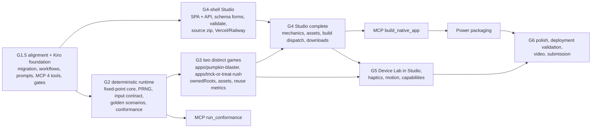

# Kiro operating model

Status: **IMPLEMENTED in G1.5** (approved). The five recipes below live unchanged in
`.kiro/workflows/`, the five prompts in `.kiro/prompts/`, and the MCP server in `tools/monstera-mcp/`.
What has been verified live in Kiro and what is still pending is recorded in
[`docs/KIRO-USAGE.md`](../docs/KIRO-USAGE.md); this document doesn't restate it.

## Principle: a Kiro-first skeleton

MONSTERA's reusable skeleton is designed around Kiro. The foundation isn't "a code generator
plus a `.kiro` folder": the generator, its contract and the generated apps are developed,
reviewed, verified and extended *through* Kiro features that are real, executable and used
every phase:

| Concern | Kiro feature | MONSTERA asset |
|---|---|---|
| Project rules | Steering | `.kiro/steering/01-…` (always) + `fileMatch` steering per area |
| What to build, phase by phase | **Kiro Specs** (requirements, design, tasks) | `.kiro/specs/g<N>-<name>/` |
| Who does what | Custom agents | `.kiro/agents/*.json` with bounded ownership |
| Guardrails that run themselves | Hooks | `.kiro/hooks/*.json` |
| Repeatable expert asks | Prompts | `.kiro/prompts/*.md` |
| Multi-agent processes with evidence | Workflows | `.kiro/workflows/*.workflow.json` |
| Structured access to the engine | Custom MCP server | `tools/monstera-mcp/` + `.kiro/settings/mcp.json` |
| Distribution to other developers | Power | `powers/monstera/` (G4, once MCP is proven) |

**The boundary is just as firm.** Generated Android and iOS applications are independent native
projects. They compile, install and run with Gradle/Android SDK and SwiftPM/xtool/Xcode only.
No generated file imports, invokes or requires Kiro. The generator may *add* optional Kiro
guidance to generated output (proposal K1 below); deleting it changes nothing about the build.

### Two kinds of "spec" (never mixed)

| | Kiro Spec | MONSTERA canonical specification |
|---|---|---|
| Path | `.kiro/specs/<feature>/{requirements,design,tasks}.md` | `apps/<id>/monstera.spec.json`, `spec/samples/**/monstera.spec.json` |
| Describes | How MONSTERA itself is developed in a phase | The app MONSTERA generates |
| Consumed by | Kiro agents, workflows, reviewers | `tools/monstera` engine, Studio, MCP server |
| Validated by | Review and workflows | `spec/schema/*.schema.json` + engine semantic rules |

Steering `04-generation-and-provenance.md` already states this; steering 06 and every prompt
and workflow below repeat the distinction wherever both appear.

## Audit of the current `.kiro/` (on `main`, `ca477be`)

| Item | State | Action in G1.5 |
|---|---|---|
| `steering/01`–`06` | Present, used | 01/02 updated for the Studio split; 07 (Studio) and 08 (runtime) added; `fileMatch` front matter where a file is area-specific |
| `agents/` (6) | Present. Fields (`name`, `description`, `prompt`, `tools`, `allowedTools`, `resources`) match the documented schema; tool names mix the documented alias `shell` with `fs_read`/`fs_write` | **Verify that each agent loads in the agent picker** (not yet confirmed); fix any tool name that doesn't resolve |
| `hooks/` (5) | Present. The guard was verified live (a real write was blocked); the 2 save hooks still need a user editor save | Owner confirms the save hooks (instructions in the G1 report); add the hooks below |
| `specs/g1-specification-engine` | Present (requirements, design, tasks; all tasks done) | Keep as the G1 record |
| `prompts/` | Empty | Add the 5 prompts below |
| `workflows/` | Missing | Add the 5 recipes below |
| `settings/mcp.json` | Missing | Add the `monstera` server |

## Agents

| Agent | Owns | New/changed |
|---|---|---|
| `monstera` | Coordination; delegates by ownership | Resources include this doc |
| `spec-engine` | `spec/`, `tools/monstera/` (engine core), `tools/monstera-mcp/` | Gains the MCP server |
| `android-native` | Android templates, `reference/g0/android` | Paths after migration |
| `ios-native` | iOS templates, `reference/g0/ios`, `tools/xtool` | Paths after migration |
| `device-lab` | `device-lab/`, `tools/scripts`, `.github/workflows` | - |
| `report-auditor` | Read-only audit of reports against evidence | Used as the final step of `monstera-release-verification` |
| `studio` (**new**) | `studio/` only (web + API); may call the engine, never edit it | New, for G4 |

Workflow steps use Kiro's bundled step agents (`wf-planner`, `wf-coder`, `wf-code-reviewer`,
`semantic_reviewer`, `wf-review-aggregator`) plus `report-auditor`. Their tool access comes from
their own definitions, and the permission rules of the launching session still apply.

## Hooks

| Hook | Trigger | Command / action | Status |
|---|---|---|---|
| `guard-generated-output` | PreToolUse (file tools) | `monstera guard-generated`: blocks hand edits to generator-owned paths | Active; extended in G3 to `apps/*/android`, `apps/*/ios`, `apps/*/MONSTERA-MANIFEST.json` |
| `validate-specs-on-save` | PostFileSave `monstera.spec.json`, `*.schema.json` | `monstera validate --all` | Active; awaits owner confirmation |
| `architecture-check-on-build-file-save` | PostFileSave build manifests | `monstera check-architecture` | Active; awaits owner confirmation |
| `gates-on-task-complete` (**new**) | PostTaskExec | `monstera gates`: tests, validate, `generate --check`, `verify`, architecture | G1.5 |
| `scenario-validate-on-save` (**new**) | PostFileSave `*.scenario.json` | `monstera validate-scenario --all --oracle` | G2 (when scenarios exist) |

`monstera gates` is a new **thin** CLI command that runs the existing checks in order and prints
one summary line per gate. It's the single definition of "green" shared by the hook, the
workflows and CI, so no logic is duplicated.

## Prompts (`.kiro/prompts/*.md`)

File prompts, invoked as `/<name> <arguments>` (`$ARGUMENTS` interpolation). Each one fixes its
inputs, the evidence it must produce, and its output format, so results are comparable run to run.

| Prompt | Arguments | Must do | Output |
|---|---|---|---|
| `architecture-review` | path, PR or Kiro Spec | Check against steering 01–08 and `architecture/*.md`; name the rule each finding violates; separate *violations* from *suggestions*; never propose game work outside the active phase | Findings table: rule, location, evidence, severity, fix |
| `native-implementation` | Kiro Spec task ID | Read the task, its requirement IDs and the design; change **templates/spec**, never generated output; regenerate; run `monstera gates` and the platform build; state the verification label reached | Diff summary, gates output, label with evidence |
| `debugging` | symptom or failing check | Reproduce first (exact command + output); state a hypothesis; change one thing at a time; stop and report after two failed fixes; record the root cause | Repro, root cause, fix, regression test |
| `conformance-review` | app id or generated dir | Compare Kotlin vs Swift behaviour for the same spec: bundled spec hash, manifests, G2 scenario results; check each divergence against the contract | Divergence table: scenario, tick, field, Kotlin, Swift, verdict |
| `security-dependency-review` | path or PR | Inventory every dependency with an exact pin and a reason; flag unpinned, unusual or typosquat-like names; check secrets handling (Studio token, Apple material), injection boundaries (schema → Kotlin/Swift/XML), CI permissions | Findings table + dependency inventory |

## Workflows (`.kiro/workflows/*.workflow.json`)

Common rules for all five:
- Every repeat has a finite `maxIterations` and pauses at the cap.
- Every hand-off goes through `.kiro/workflow-output/<recipe>/` (git-ignored; curated evidence
  is copied to `docs/evidence/`).
- No step edits generated output by hand. Generated output changes only through the generator.

| Recipe | Works today? | Fully functional from |
|---|---|---|
| `monstera-feature` | Yes | G1.5 |
| `monstera-native-generation` | Yes (generate/verify/Android build; CI watch needs `tools/kiro/watch-ci`) | G1.5 |
| `monstera-conformance` | Partly: spec/hash/manifest parity only | G2 (behavioural scenarios) |
| `monstera-adversarial-review` | Yes | G1.5 |
| `monstera-release-verification` | Yes (needs `tools/kiro/watch-ci`) | G1.5 |

`tools/kiro/watch-ci` is a small new script: a Kiro `command` watch handler. It reads the poll
JSON on stdin, runs `gh run list` for the current HEAD, and prints `idle` / `terminal-state` with
the run conclusions. It's invoked through the same `git -c alias…` pattern the hooks already use,
so it works under PowerShell and POSIX shells.

### 1. `monstera-feature`: implement one Kiro Spec task

```json
{
  "name": "monstera-feature",
  "description": "Implement one task from a Kiro Spec: plan, implement, independent review loop, quality gates.",
  "inputs": { "kiro_spec": "string", "task": "prompt" },
  "steps": [
    {
      "type": "step", "id": "plan", "agent": "wf-planner",
      "prompt": "Delete .kiro/workflow-output/feature/ if it exists. Read .kiro/steering/*.md and the Kiro Spec .kiro/specs/{{kiro_spec}}/ (requirements.md, design.md, tasks.md). Task: {{task}}. Write an ordered plan to .kiro/workflow-output/feature/plan.md: files to change, tests to add, and the requirement IDs each change satisfies. The Kiro Spec is not monstera.spec.json; do not confuse them. Do not edit source files.",
      "artifacts": { "plan": ".kiro/workflow-output/feature/plan.md" }
    },
    {
      "type": "repeat", "id": "implement-review", "maxIterations": 3, "onMaxIterations": "pause",
      "stopCondition": { "fileCheck": { "path": ".kiro/workflow-output/feature/verdict.json", "jsonPath": "verdict", "value": "APPROVED" } },
      "steps": [
        {
          "type": "step", "id": "implement", "agent": "wf-coder",
          "prompt": "Implement the plan in {{artifacts.plan}}. If .kiro/workflow-output/feature/review.md exists, first fix every blocking finding in it. Never edit generator-owned output by hand: change the spec or templates and run the generator. Run the unit tests. Commit with a message citing the requirement IDs."
        },
        {
          "type": "step", "id": "review", "agent": "wf-code-reviewer",
          "prompt": "Review the commits made for {{artifacts.plan}} against .kiro/specs/{{kiro_spec}}/requirements.md and .kiro/steering/*.md. Write findings to .kiro/workflow-output/feature/review.md. Write {\"verdict\":\"APPROVED\"} or {\"verdict\":\"CHANGES_REQUESTED\"} to .kiro/workflow-output/feature/verdict.json."
        }
      ]
    },
    {
      "type": "step", "id": "gates", "agent": "wf-coder",
      "prompt": "Run `tools/monstera/bin/monstera gates` (Windows: `py -3 tools/monstera/monstera.py gates`) and save its full output to .kiro/workflow-output/feature/gates.txt. Mark the task complete in .kiro/specs/{{kiro_spec}}/tasks.md only if every gate passed; otherwise report the failing gates and leave it open.",
      "artifacts": { "gates": ".kiro/workflow-output/feature/gates.txt" }
    }
  ]
}
```

### 2. `monstera-native-generation`: spec to compiled native projects

```json
{
  "name": "monstera-native-generation",
  "description": "Validate a canonical spec, generate both native projects, verify ownership, build Android locally and confirm CI builds both platforms.",
  "inputs": { "spec": "file", "out": "string" },
  "steps": [
    {
      "type": "step", "id": "generate", "agent": "wf-coder",
      "prompt": "Run `monstera validate {{spec}}`; stop and report the issues if it is invalid. Run `monstera generate {{spec}} --out {{out}} --check`. If it reports drift caused by the spec or templates (not by hand edits), run `monstera generate {{spec}} --out {{out}}`; if it refuses because of hand edits, stop and report them. Never use --force. Run `monstera verify {{out}}`. Write .kiro/workflow-output/native-generation/generate.json with {spec_sha256, files, verify}.",
      "artifacts": { "generate": ".kiro/workflow-output/native-generation/generate.json" }
    },
    {
      "type": "step", "id": "android-local", "agent": "wf-coder",
      "prompt": "Build the generated Android project with the Device Lab build op: DL_APP_DIR={{out}}/android bash device-lab/android/adapter.sh build. Report the JSON result line and the Gradle outcome. Do not modify generated files."
    },
    {
      "type": "step", "id": "publish", "agent": "wf-coder",
      "prompt": "Commit the regenerated output (if any) with a message naming the spec SHA-256 from {{artifacts.generate}}, and push the current branch. Never push to main."
    },
    {
      "type": "watch", "id": "ci", "handler": "command",
      "config": { "command": "git -c alias.watch-ci=!tools/kiro/bin/watch-ci watch-ci", "pollIntervalSec": 60, "commandTimeoutSec": 60 },
      "idleTimeoutSec": 3600
    },
    {
      "type": "step", "id": "report", "agent": "wf-coder",
      "prompt": "Summarize the outcome using {{artifacts.generate}} and the CI result {{ci.output}} (it may be an idle-timeout). Write .kiro/workflow-output/native-generation/report.md with the verification label reached per platform and the evidence for each. Do not claim a level without evidence."
    }
  ]
}
```

### 3. `monstera-conformance`: cross-platform behaviour

```json
{
  "name": "monstera-conformance",
  "description": "Prove the Kotlin and Swift outputs of one spec behave identically, then have two independent reviewers check the result.",
  "inputs": { "app": "string" },
  "steps": [
    {
      "type": "step", "id": "run", "agent": "wf-coder",
      "prompt": "For the generated app at {{app}}: (1) `monstera verify {{app}}`; (2) confirm both bundled monstera.spec.json copies are byte-identical and hash to the manifest's spec sha256; (3) from G2 on, run `monstera conformance {{app}}` (golden scenarios on Kotlin/JVM and Swift). Write .kiro/workflow-output/conformance/result.json and paste its summary as your final message.",
      "artifacts": { "result": ".kiro/workflow-output/conformance/result.json" }
    },
    {
      "type": "parallel", "id": "reviews", "joinPolicy": "allSettled",
      "branches": [
        {
          "type": "step", "id": "review-kotlin-first", "agent": "semantic_reviewer",
          "prompt": "Using {{artifacts.result}}, read the Kotlin runtime/shell under {{app}}/android and check that the Swift side under {{app}}/ios implements the same contract (steering 08). List every behavioural divergence with file and line. Write .kiro/workflow-output/conformance/review-kotlin-first.md."
        },
        {
          "type": "step", "id": "review-swift-first", "agent": "semantic_reviewer",
          "prompt": "Using {{artifacts.result}}, read the Swift runtime/shell under {{app}}/ios and check that the Kotlin side under {{app}}/android implements the same contract (steering 08). List every behavioural divergence with file and line. Write .kiro/workflow-output/conformance/review-swift-first.md."
        }
      ]
    },
    {
      "type": "step", "id": "aggregate", "agent": "wf-review-aggregator",
      "prompt": "Merge .kiro/workflow-output/conformance/review-kotlin-first.md and review-swift-first.md with {{artifacts.result}} into .kiro/workflow-output/conformance/report.md. Keep only divergences, each with evidence. End with CONFORMANT or DIVERGENT."
    }
  ]
}
```

### 4. `monstera-adversarial-review`: attack, don't just re-run

The G1 review showed the value: re-running checks found nothing, attacking found two real holes.
This recipe makes that the default.

```json
{
  "name": "monstera-adversarial-review",
  "description": "Attack a change (probes that try to break its guarantees) in parallel with an independent architecture review; merge into one issues-only report.",
  "inputs": { "target": "string", "guarantees": "prompt" },
  "steps": [
    {
      "type": "parallel", "id": "review", "joinPolicy": "allSettled",
      "branches": [
        {
          "type": "step", "id": "attack", "agent": "wf-coder",
          "prompt": "Target: {{target}}. Guarantees to attack: {{guarantees}}. For each guarantee, write and run probes that try to violate it (malformed inputs, path tricks, overwrite and ownership attacks, schema evolution, cross-OS bytes, concurrency/interruption). Work only in a temporary directory outside the repository and do not modify tracked files. For each successful attack, write a failing regression test into .kiro/workflow-output/adversarial/tests.patch. Write .kiro/workflow-output/adversarial/attack.md: probe, expected, observed, verdict."
        },
        {
          "type": "step", "id": "architecture", "agent": "semantic_reviewer",
          "prompt": "Review {{target}} against .kiro/steering/*.md and architecture/*.md. Report rule violations only (not style), each with location and evidence, to .kiro/workflow-output/adversarial/architecture.md."
        }
      ]
    },
    {
      "type": "step", "id": "aggregate", "agent": "wf-review-aggregator",
      "prompt": "Merge .kiro/workflow-output/adversarial/attack.md and architecture.md into .kiro/workflow-output/adversarial/report.md. Issues only, ranked by impact, each with reproduction and the proposed regression test from tests.patch. End with BLOCKERS: <n>."
    }
  ]
}
```

### 5. `monstera-release-verification`: evidence before claims

```json
{
  "name": "monstera-release-verification",
  "description": "Run every gate, wait for CI on the release head, collect evidence unchanged, and have a read-only auditor check every claim in the release report.",
  "inputs": { "release": "string", "report": "file" },
  "steps": [
    {
      "type": "step", "id": "gates", "agent": "wf-coder",
      "prompt": "Run `monstera gates` and save the output to .kiro/workflow-output/release/gates.txt. Record the HEAD commit. Stop and report if any gate fails.",
      "artifacts": { "gates": ".kiro/workflow-output/release/gates.txt" }
    },
    {
      "type": "watch", "id": "ci", "handler": "command",
      "config": { "command": "git -c alias.watch-ci=!tools/kiro/bin/watch-ci watch-ci", "pollIntervalSec": 60, "commandTimeoutSec": 60 },
      "idleTimeoutSec": 5400
    },
    {
      "type": "step", "id": "evidence", "agent": "wf-coder",
      "prompt": "CI result: {{ci.output}}. Download the artifacts of those runs with gh and copy the relevant ones unchanged to docs/evidence/{{release}}/, each folder with a SOURCE.txt (run id, job, commit, runner, what was copied). Never copy .app bundles or SDK material. Update {{report}} with the run ids and results; write no result you did not observe."
    },
    {
      "type": "step", "id": "audit", "agent": "report-auditor",
      "prompt": "Audit {{report}} against docs/evidence/{{release}}/ and the verification labels in .kiro/steering/04-generation-and-provenance.md. For every claim, cite the evidence file or mark it UNSUPPORTED. Flag any label higher than its evidence. End with VERDICT: PASS or VERDICT: FAIL."
    }
  ]
}
```

## Kiro Specs per phase

| Phase | Kiro Spec | Status |
|---|---|---|
| G1 | `.kiro/specs/g1-specification-engine/` | Done |
| G2 | `.kiro/specs/g2-deterministic-runtime/` | **Proposed** (this branch) |
| G3 | `.kiro/specs/g3-demonstration-games/` | Written at G3 start, after G2 approval |
| G4 | `.kiro/specs/g4-studio/` (shell part written at G4-shell start) | Planned |
| G5 | `.kiro/specs/g5-native-capabilities/` | Planned |

Each phase runs its tasks through `monstera-feature`, finishes with `monstera-adversarial-review`
and `monstera-release-verification`, and records workflow run ids in `docs/KIRO-USAGE.md`.

## MCP server

Full design: [`architecture/MONSTERA-MCP.md`](MONSTERA-MCP.md). Four tools in G1.5, all thin
adapters over existing engine functions: `validate_spec`, `generate_project`, `inspect_manifest`,
`get_device_report`. `run_conformance` arrives with G2's runner, and `build_native_app` with
Studio build dispatch (G4).

## Power (G4)

`powers/monstera/` (Agent Plugins format: `plugin.json`, `mcp.json`, `skills/`), installable through
**Add Custom Power → Import power from GitHub**. It gives developers *outside this repository*
(forks, users of Studio-generated source) the MCP tools and three skills:
- `create-game-spec`
- `regenerate-native-projects`
- `extend-generated-app`

It's built only after the MCP server has been used in this repository's own development. Before
that, a power would just be packaging.

## Kiro guidance in generated projects (proposal K1)

So that developers can extend *generated* projects with Kiro without making Kiro a dependency, the
generator would emit one optional, generator-owned file in each app (and in Studio source zips):
`.kiro/steering/monstera-generated.md`. It explains which files are generated, that changes go into
`monstera.spec.json` + regeneration, and the native conventions. It's plain Markdown. Builds never
read it, and deleting it has no effect on compiling, installing or running.

## Evidence of Kiro use

`docs/KIRO-USAGE.md` (new, kept current every phase) maps each Kiro feature to concrete repository
artifacts and recorded use:
- workflow run ids and outcomes,
- hooks observed firing,
- Kiro Spec tasks completed,
- MCP tool calls made during development,
- review findings fixed.

It's the source for the Devpost "how we used Kiro" description.

## Execution dependencies


